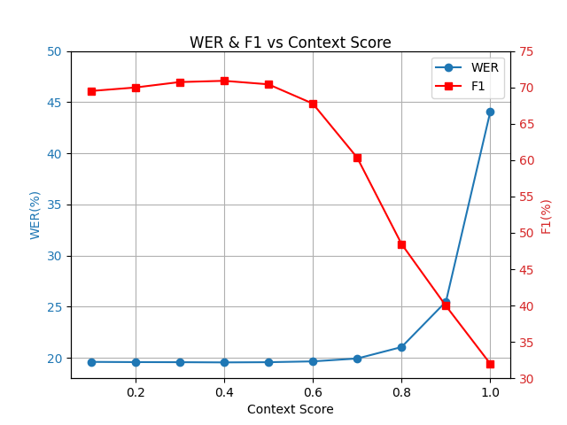
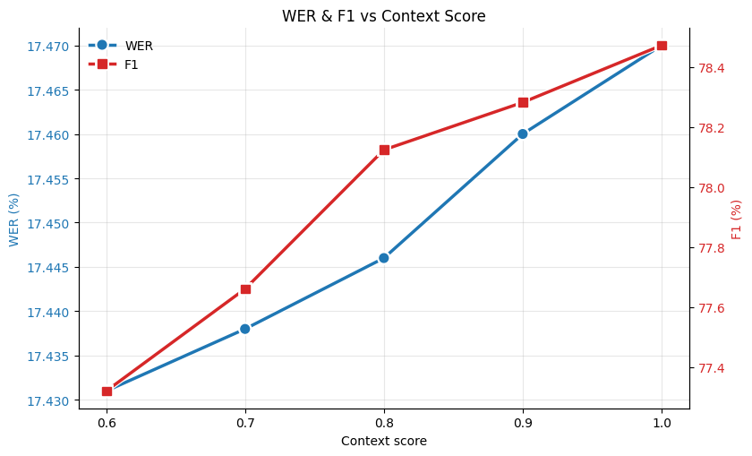
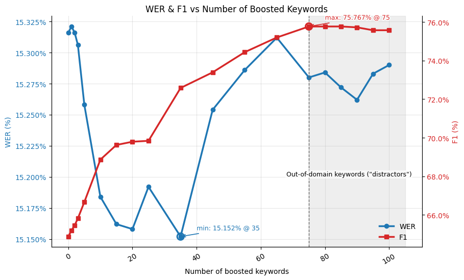

# Keyword boosting

Keyword boosting is a technique to improve the recognition of domain-specific
words/phrases and proper nouns. It works by boosting the
probability of specific tokens at inference time.
The framework is inspired by [TurboBias](https://arxiv.org/abs/2508.07014) [1].

The framework can support up to 100 keywords,
although 10-40 is recommended for optimal performance.

```admonish
While keyword boosting is enabled for both greedy and beam decoding, it is designed to work well with beam decoding and may not perform well with greedy decoding.
```

## Keyword list format

Create a `json` containing your keywords, in the following format:

```json
{
  "keywords": [
    "car",
    " cat",
    " Bat ",
    " New York "
  ]
}
```

Keywords are case and space sensitive, they should be formatted using the same
character-set as the output of your decoder.

In the above example, the framework would increase
the probabilities of words containing the sequence `car`,
words starting with `cat`, the __whole__ word `Bat`,
and the __whole__ phrase `New York`.

## Keyword metrics

When a valid JSON is passed to `--keywords_path`, additional metrics are calculated:

- **Biased WER (b-WER)**: WER of hypotheses that contain at least one keyword in the reference.
- **Unbiased WER (u-WER)**: WER of hypotheses that do not contain any keywords in the reference.
- **Precision**: TP/(TP+FP) - Accuracy of keyword predictions (i.e., how many of the keywords that the model predicted were correct).
- **Recall**: TP/(TP+FN) - Model's ability to find all keywords (i.e., what proportion of keywords in the ground truth did the model correctly predict).
- **F1 Score**: Harmonic mean of precision and recall.

## Usage

### Compute metrics

To compute metrics on your keywords, pass a valid JSON to the `--keywords_path` argument:

```bash
./scripts/val.sh \
  # ... other args ...
  --keywords_path path/to/words.json
```

```admonish
Computing metrics is compatible with both the greedy and beam decoders.
```

### Boost keywords

To boost the keywords, additionally supply the `--boost_keywords` flag:

```bash
./scripts/val.sh \
  # ... other args ...
  --keywords_path path/to/words.json
  --boost_keywords
```

## How it works

We build an Aho-Corasick automaton over your phrases.
Each node has a depth-shaped potential:

```
shape(d) =
            0                     if d = 0
            c0                    if d = 1
            c0*beta + ln(d)       if d >= 2

S(d) = context_score * shape(d)
```

At each token, we follow AC failure links (refunding partial bias),
then take a goto edge (adding the incremental bias).
Completed keywords keep their reward; partial near-misses net ≈ 0.
This design is deterministic, efficient, and robust to overlaps, large lists and out-of-domain distractors.

## Hyperparameters

- `--keyword_boost_c0` (default 0.3): start-of-keyword boost (depth 1).
- `--keyword_boost_beta` (default 0.9): extra front-loading at depth 2; later steps taper via ln(depth).
- `--keyword_boost_context_score` (default 0.4 for greedy decoder, 1.0 for beam decoder): global strength.

### Recommendations

Keep `c0` and `beta` at their defaults; they work well across domains
and for different keyword list sizes (up to 100).

- ### Greedy Decoder

  If you wish to trade F1 vs WER (*figure 1*), adjust only `context_score`:

  - Try 0.1-0.6

  - Lowering towards 0.1 -> slightly better WER and precision, slightly lower F1 and recall.

  - Exceeding 0.6 typically degrades both WER and F1.

  - Default 0.4 is recommended.

    

    *Figure 1: WER and F1 vs context score, averaged across 4 test datasets with 10-15 keywords each.*

- ### Beam Decoder

  If you wish to trade F1 vs WER (*figure 2*), adjust only `context_score`:

  - Try 0.6-1.0

  - Lowering towards 0.6 -> slightly better WER and precision, slightly lower F1 and recall.

  - Exceeding 1.0 typically degrades both WER and F1.

  - Default 1.0 is recommended.

    

    *Figure 2: WER and F1 vs context score, averaged across 4 test datasets with 10-15 keywords each.*

  See *figure 3* for scaling with the number of boosted keywords. Guidance:

  - Recommended: 10-40 keywords

  - Maximum: 100 keywords

  - Although the framework is remarkably robust to out-of-domain "distractors",
    best results come from keeping the list of keywords relevant.

    
    *Figure 3: WER and F1 versus the number of boosted keywords for one test dataset. The shaded region (>75) adds out-of-domain “distractor” phrases in addition to the original 75 relevant ones.*

## Expected Results

When boosting is enabled:

- F1: 10-40% relative improvement
- WER: up to ~1% relative improvement

Actual gains vary by domain, audio conditions, and list composition.

## References

[1] A. Andrusenko, V. Bataev, L. Grigoryan, V. Lavrukhin, and B. Ginsburg,
‘TurboBias: Universal ASR Context-Biasing powered by GPU-accelerated Phrase-Boosting Tree’, arXiv [eess.AS]. 2025.
